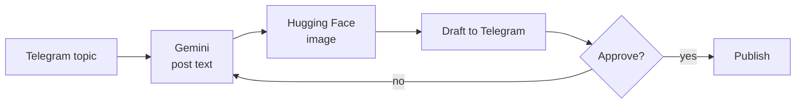

# AI Content Bot for Telegram

> Telegram bot in n8n: Gemini writes the post, Hugging Face generates the image, a human approves before publishing.

 

## Problem

Creating regular posts with images took a lot of manual time.

## Solution

Built in **n8n**:

1. The user sends a topic to the Telegram bot
2. Google Gemini writes the post text
3. A Hugging Face image model generates a matching image
4. The draft is sent back for approval — human in the loop before anything is published

## Architecture

## Tech stack

- n8n
- Google Gemini
- Hugging Face Inference API
- Telegram Bot API

## Results

- A ready post with an image in about a minute
- Nothing is published without human approval

## Workflow files

Workflow JSON exports are in [`workflows/`](workflows). Credentials, IDs and personal data are removed: import into n8n and connect your own credentials.

## Author

**Kyrylo Kirillov** — AI Automation Engineer (n8n, Make, LLM agents)  
[Upwork](https://www.upwork.com/freelancers/~019bcb1ca9cd59b3ad) · [LinkedIn](https://www.linkedin.com/in/kirillov-kirill) · [Portfolio](https://tree-plantain-8cf.notion.site) · Telegram [@Veter218](https://t.me/Veter218)

